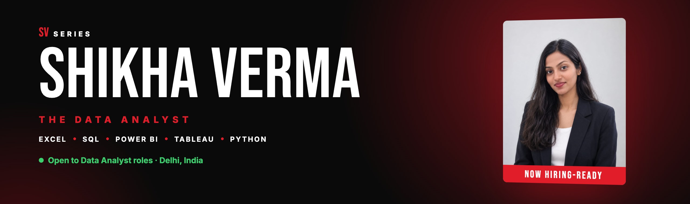
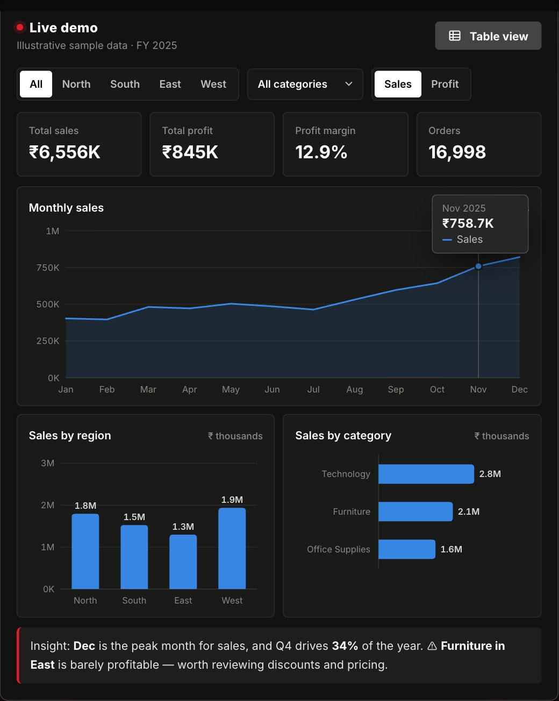

### Hi, I'm Shikha 👋 an entry-level **Data Analyst** who turns messy data into clear, decision-ready dashboards.

---

### 🧭 About me

- 📊 **Data Analyst Intern** at **Claudreck Technologies** (May – Jul 2026): data cleaning, dashboards in Excel, Power BI & Tableau, and SQL for reporting
- 🎓 **Certified in Data Analytics with Gen AI**, Physics Wallah (Feb – Oct 2026)
- 🌱 **McKinsey.org Forward Program** (2026): problem-solving, communication & leadership
- 📚 Pursuing an **M.A. in Sociology** (IGNOU), which helps me understand the people behind the numbers
- 📍 Delhi, India · **Open to entry-level Data Analyst roles**

### 🧰 Toolkit

  
  
  
  
  
  
  
  

**What I do:** Data Cleaning · Exploratory Data Analysis · Descriptive Statistics · KPI Dashboards · Pivot Tables & Charts · XLOOKUP/VLOOKUP · Analytical Reporting

---

### 📊 Featured project

<table>
<tr>
<td width="50%" valign="top">

</td>
<td width="50%" valign="top">

#### Sales Performance Dashboard
`Excel` `Pivot Tables` `Pivot Charts` `KPIs`

Tracks **sales, profit, margin and regional performance** so managers can spot trends and under-performing segments at a glance.

- Cleaned and organised raw sales data
- Built an interactive dashboard with Pivot Tables, Pivot Charts & formulas
- Communicated insights through visuals and reports

**[▶ Try the live demo](https://shikhaverma09.github.io/data-analyst-portfolio/#originals)** · **[📁 Repo](https://github.com/shikhaverma09/data-analyst-portfolio)**

</td>
</tr>
</table>

### 🔄 How I work

---

**🎬 Next episode: my first full-time Data Analyst role. Could it be on your team?**

[work.shikhaverma@gmail.com](mailto:work.shikhaverma@gmail.com) · [LinkedIn](https://www.linkedin.com/in/shikha-verma9112) · [Portfolio](https://shikhaverma09.github.io/data-analyst-portfolio/)

